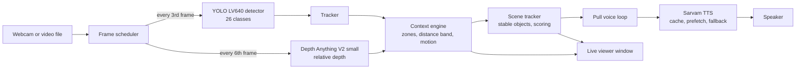
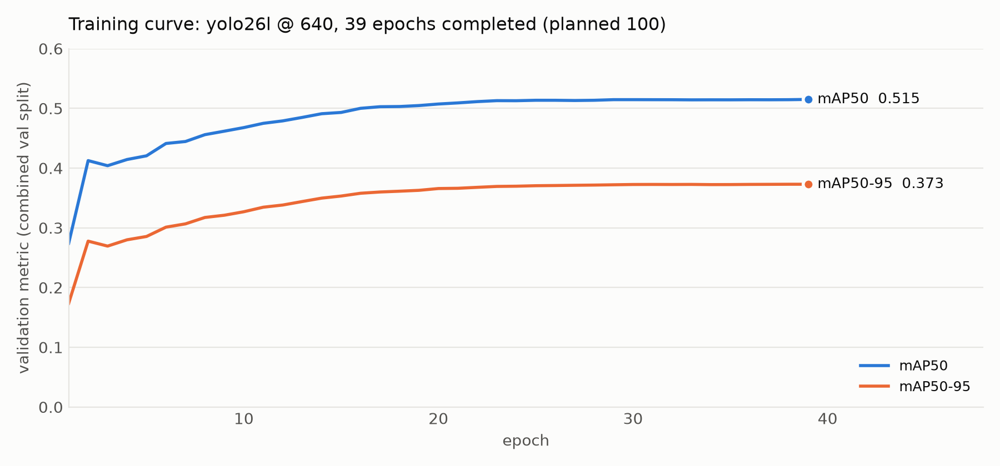
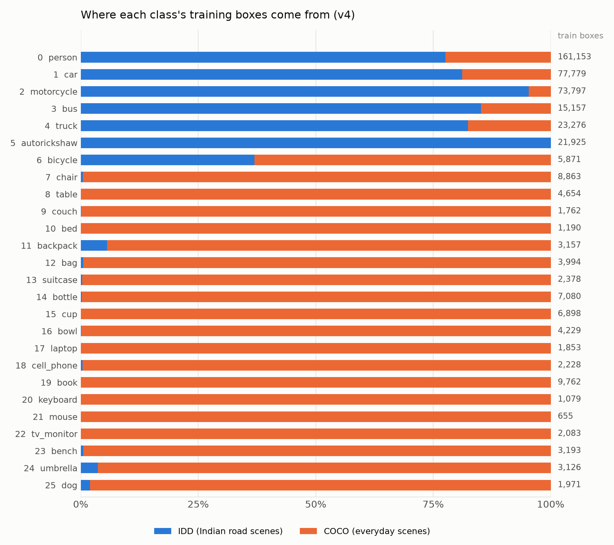
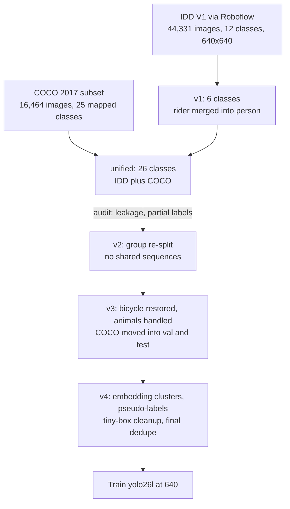
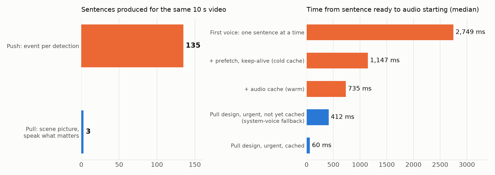
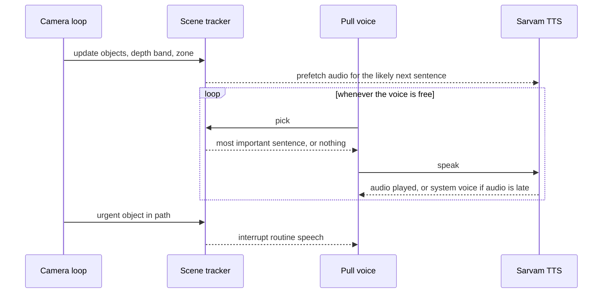
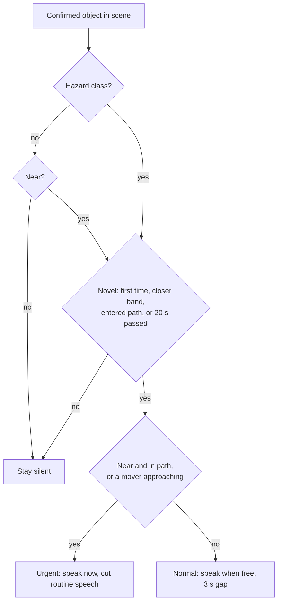
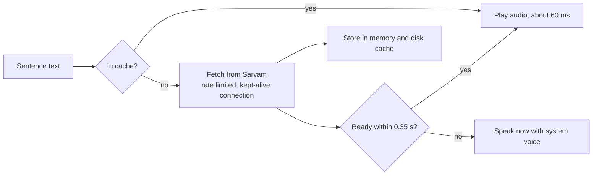

<div align="center">

# LensVoice

**A laptop-only AI accessibility assistant for blind users.**
A camera feeds a perception stack; the assistant speaks **only what the evidence supports**: no invented distance, speed, intent or identity.


</div>

---

## Table of contents

1. [What it does](#1-what-it-does)
2. [Highlights](#2-highlights)
3. [System architecture](#3-system-architecture)
4. [The detector: LV640](#4-the-detector-lv640)
5. [Dataset engineering: v1 to v4](#5-dataset-engineering-v1-to-v4)
6. [Narration and voice](#6-narration-and-voice)
7. [Hurdles and how we solved them](#7-hurdles-and-how-we-solved-them)
8. [Quickstart](#8-quickstart)
9. [Configuration reference](#9-configuration-reference)
10. [Repository layout](#10-repository-layout)
11. [Testing](#11-testing)
12. [Scalability and extensibility](#12-scalability-and-extensibility)
13. [Limitations and roadmap](#13-limitations-and-roadmap)
14. [Reference: contracts, taxonomy, privacy](#14-reference-contracts-taxonomy-privacy)
15. [Team, credits and licenses](#15-team-credits-and-licenses)

---

## 1. What it does

```
camera -> detect objects -> track -> reason (where, how close, moving?) -> decide what matters -> speak
```

A blind user holds or wears a camera. LensVoice detects 26 kinds of everyday and road objects, estimates where they are and how close they are *relative to the scene*, keeps a small stable picture of the surroundings, and, only when the voice is free, says the single most important thing, in natural language:

> *"I can see a TV on your left, a couch on your right and a few chairs straight ahead."*
> *"Careful, there's a chair right in front of you."*
> *"Watch out, someone is coming toward you, on your left."*

**Design principles**

| Principle | What it means in code |
|---|---|
| Evidence only | Sentences are built from measured fields (class, side, relative distance, in-path, coming closer). No metres, no speed, no intent, no emotion. |
| Silence is valid | A quiet room stays quiet. Nothing is spoken just because something was detected. |
| One place for language | All sentences come from `narration/narrator.py`. |
| Frameworks stay behind adapters | No Ultralytics, torch or PaddleOCR types leak into the pipeline. |
| Config, not code | Weights, thresholds, voices and modes live in YAML. Real adapters refuse to run with an unset weight. |

---

## 2. Highlights

| | |
|---|---|
| **Detector** | YOLO26-large, 26 classes, 640 px. **mAP50 0.515 / mAP50-95 0.373** on the combined validation split (P 0.610, R 0.507). |
| **Speed** | About **40 ms per frame** for the detector and **28 ms** for depth on an Apple-silicon MacBook Air (MPS). The live viewer runs at roughly **15-17 fps** at 1280x720. |
| **Dataset** | **56,692 images**, 42,109 train / 7,248 val / 7,335 test. **0 cross-split near-duplicate pairs and 0 exact duplicates** (exact all-pairs perceptual-hash check). |
| **Narration** | **135 sentences became about 3** for the same 10-second video, with the important ones kept. |
| **Voice latency** | Urgent sentences start in about **60 ms** when cached and about **400 ms** the first time (instant system-voice fallback). The first version took a median of 2,749 ms. |
| **Quality gate** | **113 automated tests**, all passing. |

---

## 3. System architecture



**Per frame:** the scheduler decides which models run (detector about 10 Hz, depth about 5 Hz on a 30 fps camera). Detections are tracked, placed into a 3x3 zone grid and a relative-depth band (very near, near, medium, far), and handed to the **scene tracker**. A separate voice thread asks the scene "what is the single most important thing to say right now?" whenever it is free to speak.

Two narration modes exist behind one config switch (`narration.mode`):

| Mode | Behaviour | Use |
|---|---|---|
| `push` (legacy) | Every event becomes a queued sentence (change detection, safety, priority, audio queue). | Mock runs, tests. |
| `pull` (live) | No queue. The scene is kept stable and the voice pulls the best sentence when free. | Real use. |

---

## 4. The detector: LV640

### 4.1 Specification

| | |
|---|---|
| Architecture | YOLO26-large (26.2 M parameters), NMS-free head |
| Input | 640 x 640 |
| Classes | 26 (locked taxonomy, see [section 14](#14-reference-contracts-taxonomy-privacy)) |
| Training data | LensVoice v4: IDD (Indian road scenes) + COCO (everyday scenes) |
| Optimiser | AdamW, lr0 3.33e-4, cosine schedule, 3 warm-up epochs, weight decay 5e-4 |
| Batch / precision | 32, mixed precision |
| Augmentation | mosaic 1.0 (closed for the last 10 epochs), scale 0.5, translate 0.1, HSV, horizontal flip 0.5 |
| Seed | 0 (deterministic) |
| Compute | Google Colab GPU |
| Epochs | **39 completed** of a planned 100; best epoch is the last one saved |
| Size | about 53 MB after stripping optimizer state (210 MB raw checkpoint) |

### 4.2 Accuracy

Validation metrics recorded by the training run for the selected checkpoint (`lv640_best.pt`) on the **combined v4 validation split** (7,248 images):

| Metric | Value |
|---|---|
| **mAP50** | **0.515** |
| **mAP50-95** | **0.373** |
| Precision | 0.610 |
| Recall | 0.507 |



The curve flattens from about epoch 25 (mAP50 gains of roughly 0.0002 per epoch at the end), so more epochs on this data would add little. Gains now have to come from data, not training time.

**Model variants**

| Model | Setup | mAP50 | mAP50-95 | P | R | Status |
|---|---|---|---|---|---|---|
| `lv640_best.pt` | yolo26l, 640 px, 39 epochs | **0.5149** | **0.3729** | 0.610 | 0.507 | **Selected** |
| `best.pt` | 10-epoch fine-tune of the above at 960 px | 0.5135 | 0.3706 | 0.628 | 0.498 | Fallback (set `imgsz: 960`) |
| 12-class baseline | yolo26n, 150 epochs, earlier dataset | 0.153 | n/a | n/a | 0.167 | Reference only. Different class set and data, **not comparable**. |

> The 960 px fine-tune did not beat the 640 px model on its own metric, and it is slower, so the 640 px model is the default.

### 4.3 Runtime speed (measured)

Apple-silicon MacBook Air, MPS, warm model, single image:

| Component | Time |
|---|---|
| YOLO26-large @ 640 | about 41 ms |
| Depth Anything V2 small, input short side 252 | about 28 ms (190 ms at 518) |
| End-to-end with live viewer, 1280x720 | about 15-17 fps |
| First frame (model warm-up) | about 2 s |

### 4.4 What the model is good and bad at

- **Strong signal on road scenes:** person, car, motorcycle, bus, truck and autorickshaw have tens of thousands of boxes and come from IDD *and* COCO.
- **Indoor classes (7-25) are COCO-only.** They had no IDD labels at all. The model learned them from COCO photographs, so they transfer to real rooms but are the weakest part of the system.
- **Small objects are hard.** About 43% of training boxes in the unified-dataset audit covered less than 0.2% of the image, partly because IDD was exported at 640x640.



---

## 5. Dataset engineering: v1 to v4

Most of the project's effort went into making the data trustworthy. Every version fixed a specific, measured problem.



| Version | What changed | Why | Key numbers |
|---|---|---|---|
| **IDD + COCO sources** | IDD V1 (Roboflow export, resized 640x640 stretch, CC BY 4.0) and a COCO 2017 subset | Road scenes alone cannot teach indoor objects | 44,331 IDD + 16,464 COCO images |
| **v1** | IDD reduced to 6 classes, rider merged into person, empty images kept as hard negatives | Animal, bicycle, traffic light/sign and vehicle-fallback classes were too rare or noisy | 12-class baseline had reached only mAP50 0.153 |
| **unified** | 26 classes, COCO mapped by name, near-duplicate prune | One taxonomy for both worlds | 44,096 / 10,387 / 4,433 images |
| **audit** | Read-only review of the unified set | See hurdles 1-4 | **3,764 near-duplicate pairs across splits**; test covered **6 of 26** classes |
| **v2** | IDD split by filename-ID groups plus near-duplicate unions; COCO val split into val and test | Remove shared drives and give val/test both sources | 0 cross-split pairs; 17 classes below 300 val boxes |
| **v3** | Bicycle restored from raw IDD; animal boxes classified; COCO train images moved into val/test | Fix dropped classes and thin validation | every class at least 300 val/test boxes |
| **v4** | DINOv2 embedding clusters for the IDD split; pseudo-labels; tiny-box cleanup; final dedupe | Strongest leakage control | **19,941 clusters, 0 spanning splits** |

**Final v4 dataset**

| Split | IDD | COCO | Total |
|---|---|---|---|
| train | 28,174 | 13,935 | **42,109** |
| val | 6,038 | 1,210 | **7,248** |
| test | 6,038 | 1,297 | **7,335** |

Every class has at least 300 boxes in val and test except **dog, which has 299 validation boxes**.

Leakage control: the nearest-train-neighbour check (share of val images whose closest train image is within cosine distance 0.12) fell from **59.6% to 27.5%** between the v3 and v4 splits.

---

## 6. Narration and voice

### 6.1 The core idea: narrate decisions, not detections

The first design pushed a sentence into a queue for every detection event. On a 10-second clip it produced **135 sentences**, mostly "cup, far away, ahead". One voice can say roughly one sentence every 1.5 s, so about 95% could never be spoken, and what *was* spoken was chosen by arrival order, not importance.

The live design flips this: keep a **small stable picture of the scene** and let the voice **pull** the best sentence when it is free.





### 6.2 How the scene decides what to say



- **Stable objects:** an object exists once seen in 3 of the last 4 detection ticks and is dropped after 1 s unseen. A new tracker id on top of a recent same-class box is the *same* object, so id churn cannot cause repeat announcements. Distance band, zone and "in path" must hold for 2 ticks before they change.
- **Score:** `class_weight x proximity x (2 if in path) x (1.5 if approaching) x novelty`. The top candidate is spoken.
- **Clutter gate:** small handheld items (cup, bottle, bowl, book, phone, mouse, keyboard, laptop) are never announced unless near. Hazard classes (people, vehicles, dog, chair, table, bench, couch, bed) are announced at any distance, once.
- **"Approaching" is only for movers.** A chair never "approaches"; that is the camera moving. If most objects seem to approach at once, the motion is ignored as ego-motion.

| Level | Example | Behaviour |
|---|---|---|
| Urgent | "Careful, there's a chair right in front of you." | Interrupts routine speech. 4 s cooldown per object, 2 s between urgents. |
| Normal | "There's a table on your left, close by." | Spoken when the voice is free, at least 3 s apart. |
| Ambient | "I can see a TV on your left, a couch on your right and a few chairs straight ahead." | At start, on request (`s` key), or after 25 s of silence. |

Same-class neighbours are grouped ("a few chairs straight ahead"). Counts are spoken as "a couple" or "a few" rather than exact numbers we might get wrong.

### 6.3 Voice: Sarvam AI

Speech uses **Sarvam AI bulbul:v3** (a cloud API; the pipeline, models and playback run on your machine). The key is read only from an environment variable.



| Feature | Purpose |
|---|---|
| Background prefetch | Audio is fetched the moment a sentence is likely, overlapping with speech in progress |
| Persistent HTTPS connections | No connection set-up per sentence |
| Memory + disk cache (`~/.cache/lensvoice/tts`) | A sentence is fetched once, ever |
| Global rate limiter with 429 backoff | A rejected request waits instead of hammering the API |
| Instant system-voice fallback (0.35 s for urgent) | A warning is never late; Sarvam keeps fetching it for next time |
| Urgent-sentence warm-up at start (about 74 sentences) | Urgent audio is already cached after the first session |
| Summary pre-fetch | The scene summary is frozen early and spoken the moment its audio is ready |

---

## 7. Hurdles and how we solved them

| # | Problem | Evidence | Fix | Result |
|---|---|---|---|---|
| 1 | **Train/val/test leakage**: IDD frames from the same drives sit in different splits | 3,764 near-duplicate cross-split pairs; filename IDs spread over all splits | Group split by ID plus near-duplicate unions (v2), then DINOv2 embedding clusters (v4) | 0 cross-split pairs; nearest-neighbour leakage 59.6% to 27.5% |
| 2 | **Test set covered only 6 of 26 classes** | Test was IDD only; classes 6-25 had 0 test boxes | COCO validation images split into val and test; COCO train images moved in until every class has at least 300 boxes | Val and test cover all 26 classes |
| 3 | **Partial labels**: indoor classes exist only in COCO, road classes mostly in IDD | Classes 7-25 were 100% COCO; autorickshaw 100% IDD | Documented per-source evaluation yaml files; pseudo-labels; bicycle restored | Improved, but IDD images still have no indoor labels (a limitation) |
| 4 | **Classes silently dropped in conversion** | 3,326 bicycle and 6,682 animal boxes removed by the v1 converter | Bicycle restored (3,223 boxes). Animals classified with a COCO model | Bicycle labelled for both sources |
| 5 | **Animal boxes unclassifiable** | Median animal box about 10x9 px at 640x640 | Strict rule (dog only at conf 0.5 or more); images with unconfirmed animals removed | Only 9 dogs recovered; 2,164 images removed |
| 6 | **Pseudo-labelling yield was tiny** | 720 raw detections over 28k street images | Kept the strict thresholds (0.6 / 0.7, IoU below 0.4) | 443 boxes on 403 images, clearly a small patch |
| 7 | **No test-time augmentation for YOLO26** | Ultralytics reverts to single-scale for the NMS-free head | Documented; single-scale used | None needed |
| 8 | **Pseudo-label job too slow on a Mac** | 0.76-1.2 s per image on MPS at 1280 px (about 6-7 hours) | Moved to a Colab GPU: 0.13 s per image (about 45 minutes) | 20,190 images in under an hour |
| 9 | **1.25 GB upload impossible on the available network** | Upload to Colab failed | Colab downloads the same images from the Roboflow export itself; only a 550 KB name list was uploaded, with filename and byte-size verification | All images matched |
| 10 | **Depth direction inverted** | Docs say 1.0 = closest; `spatial.py` treated small values as near, and its tests encoded that | Fixed the semantics and tests | Near and far are now correct |
| 11 | **Distance missing on half of detections** | Depth ran every 6th frame, detection every 3rd, and depth was discarded in between | Depth map is held between updates | Every detection gets a distance |
| 12 | **Mock depth and mock OCR spoke fake facts** ("stop sign ahead") | Canned outputs appeared in real-video runs | Real depth model; `mock: false` null models for OCR and signs | No fabricated sentences |
| 13 | **Nothing spoke during a live run** | The audio queue was only drained at exit | Playback worker, later the pull voice loop | Continuous speech |
| 14 | **Voice latency** | Median 2,749 ms from sentence to audio | Prefetch, kept-alive connections, disk cache, fallback voice, urgent warm-up | About 60 ms cached, about 400 ms first time |
| 15 | **Sarvam rate limit** | A 416-sentence warm-up caused HTTP 429; 465 API calls for 25 spoken sentences | Global limiter with backoff, a gentle low-priority warm-up, a smaller set | 0 rate-limit errors in later runs |
| 16 | **Sentence flood** | 135 sentences for a 10-second clip; 22 stale and 124 repeated in a live run | Pull design: stable scene, scoring, gating, grouping | 3 sentences for the same clip |
| 17 | **Words cut off mid-sentence** | Urgent alerts interrupted routine speech repeatedly | Urgent sentences are rare and spaced; routine speech is never cut by routine speech | Clean sentences |
| 18 | **False "approaching" from a moving camera** | 19 of 25 live sentences were urgent | Movers only; ego-motion filter; urgent spacing | Urgent sentences became rare |
| 19 | **Robotic wording** ("couch approaching, close, right") | User feedback | Human phrasing built from measured facts only | See section 1 |
| 20 | **Secrets handling** | An API key was pasted into chat during development | Key is read only from an environment variable and never written to a file, log or cache; the exposed key was flagged for rotation | No key anywhere in the repository |

---

## 8. Quickstart

```bash
# install
venv/bin/python -m pip install -e .
venv/bin/python -m pytest tests/ -q                 # 113 tests, no GPU, no network

# mock run: no camera, models or weights needed
venv/bin/python scripts/run_pipeline.py --mock --frames 100 --drain
```

**Live (webcam or video) with the trained model**

```bash
# weights: put lv640_best.pt anywhere, then link it (gitignored)
ln -s /path/to/lv640_best.pt models/lv640_best.pt

export SARVAM_API_KEY='your-key'        # terminal only; never put the key in a file

venv/bin/python scripts/run_pipeline.py --config configs/lv640_live.yaml --show
venv/bin/python scripts/run_pipeline.py --config configs/lv640_live.yaml --show --source path/to/video.mp4
```

| Flag | Effect |
|---|---|
| `--show` | Live window: boxes, class, distance, zone, "in path" highlight, depth inset, subtitles, voice lag |
| `--source` | Camera index (e.g. `0`) or a video file, played at its own speed |
| `--silent` | No voice and no API key needed; subtitles show what would be said |
| `--record out.mp4` | Save the annotated view |
| `--warm-voice` | Pre-fetch a larger set of sentences slowly in the background (billed once) |
| `--sarvam-only` | Never fall back to the system voice |
| `--no-realtime` | Process every video frame as fast as possible |

**Viewer keys:** `q` / Esc quit, `d` full depth overlay, `s` scene summary, `p` pause.

First run: the depth model (about 100 MB) downloads once. On macOS, allow camera access for your terminal.

---

## 9. Configuration reference

All tunables live in YAML (`configs/default.yaml`, `configs/lv640.yaml`, `configs/lv640_live.yaml`).

| Key | Meaning | Live default |
|---|---|---|
| `models.yolo.weight` / `device` / `imgsz` | Detector weights, `mps`, `cuda` index or `cpu`, input size | `models/lv640_best.pt` / `mps` / 640 |
| `models.yolo.confidence` | Detection threshold | 0.40 |
| `models.depth.weight` / `imgsz` | Depth model and its input short side | Depth Anything V2 small / 252 |
| `narration.mode` | `push` or `pull` | `pull` |
| `narration.min_gap_normal_s` | Silence between routine sentences | 3.0 |
| `narration.urgent_cooldown_s` / `urgent_min_gap_s` | Per-object and global urgent spacing | 4.0 / 2.0 |
| `narration.confirm_hits` / `confirm_window` | Sightings needed before an object exists | 3 of 4 |
| `narration.hazard_classes` / `handheld_classes` | Which classes are announced at range, which only when near | see `settings.py` |
| `tts.provider` / `voice` / `pace` | `sarvam` or `silent`, speaker, speed | sarvam / priya / 1.1 |
| `tts.fallback_local_ms` | Wait for Sarvam audio before the system voice speaks | 350 |
| `tts.max_rps` | Starting request rate to the API (halves on a 429) | 2.0 |
| `tts.cache_dir` | Persistent audio cache | `~/.cache/lensvoice/tts` |

---

## 10. Repository layout

```
src/lensvoice/
  models/        perception adapters (YOLO, depth, OCR, signs, scene) and mock models
  tracking/      mock IoU tracker and ByteTrack adapter
  reasoning/     spatial, temporal, change detection, safety, priority
  narration/     narrator (all wording), scene tracker and pull voice, phrase sets
  audio/         TTS interface, Sarvam provider, priority queue
  camera/        mock camera, webcam and video-file source
  display/       live viewer
  runtime/       pipeline orchestration
  config/        typed settings
  telemetry/     structured logging (redacts images and text), metrics
configs/         default, LV640 and live configs
scripts/         run_pipeline.py (entry point)
tests/           unit and integration tests
tools/           dataset build and audit tooling
training/        GPU training and export scripts
docs/            architecture, model contract, pipeline notes, README charts
```

`src/lensvoice/models/` holds **adapters**; the root `models/` folder holds **weights** (gitignored, transferred out of band).

---

## 11. Testing

```bash
venv/bin/python -m pytest tests/ -q          # 113 passing
```

| Area | What is covered |
|---|---|
| Config, schemas, scheduler, tracker, spatial, temporal | Unit tests |
| Narration and audio queue | Priority order, staleness, repeats, gaps, interrupts |
| Sarvam provider | Request shape against a local fake server, caching, disk cache, 429 backoff, legacy-field fallback, fallback voice, warm-up behaviour |
| Scene and pull voice | Confirmation, flicker, id churn, hysteresis, gating, novelty, urgency, grouping, pacing, summary, wording rules (no invented distance, speed or emotion) |
| Video source and viewer | Clean end of video, real-time pacing, frame skipping, drawing logic |
| Integration | Full mock pipeline, including pull mode, end to end |

All Sarvam tests run offline against a fake HTTP server, so the suite needs no network or API key.

---

## 12. Scalability and extensibility

| Need | How |
|---|---|
| Swap or add a perception model | Implement one of the five interfaces in `models/interfaces.py` and point the config at it. Nothing downstream changes. |
| Different voice | Implement the `TTS` interface (`speak`, optional `stop`, `prefetch`, `is_ready`). Sarvam is one provider; `silent` is another. |
| More languages | Sarvam's text-to-speech accepts 11 language codes (English-India plus ten Indian languages such as `hi-IN`, `ta-IN`, `te-IN`). Set `tts.language`; wording would need a translation step. |
| More classes | Extend the taxonomy, add data, retrain; the runtime reads class names from the model and config. |
| Faster detection rate vs speech | Perception and speech are decoupled: the voice only asks the scene what matters, so detection rate can change freely. |
| Smaller or faster models | The adapter takes any Ultralytics-compatible weight; exports (ONNX/TFLite) live under `training/`. |
| Rate limits and costs | A global limiter, disk cache and prefetch bound API traffic; each distinct sentence is paid for once. |
| Reproducible data | Every dataset version is rebuilt by scripts; a labels-only package with a manifest (SHA-1, size, source) and a parallel, resumable image rebuild script was produced for GPU machines. |

---

## 13. Limitations and roadmap

**Known limitations (stated honestly)**

- **Accuracy is moderate** (mAP50 0.515). Small and distant objects are the weakest area.
- **Indoor classes learned from COCO only.** The domain gap to a real room or a phone screen filmed by a webcam is untested numerically.
- **Training stopped at 39 of 100 planned epochs**, at a plateau; improvements need better data, not more epochs.
- **Distance is relative to the scene**, from a monocular depth model. It is never metres.
- **"Approaching" uses box growth.** The ego-motion filter is simple; fast hand-held motion can still fool it.
- **The voice depends on a cloud API** for Sarvam audio (sentences, never images, are sent). The system voice is the offline fallback.
- **Pseudo-labelling added only 443 boxes**; IDD images still lack indoor labels.
- **No user study with blind users yet.**

**Roadmap**

- Per-class and per-source evaluation on the held-out test split, published alongside releases.
- Real OCR and traffic-sign models (adapters exist; weights and installs are pending).
- A "find my cup" query mode and a push-button "what is around me" request.
- Camera-motion compensation for approach detection.
- Translation and multilingual voice.
- On-device export and packaging.

---

## 14. Reference: contracts, taxonomy, privacy

### Taxonomy (locked, 26 classes)

| id | class | id | class | id | class |
|----|-------|----|-------|----|-------|
| 0 | person | 9 | couch | 18 | cell_phone |
| 1 | car | 10 | bed | 19 | book |
| 2 | motorcycle | 11 | backpack | 20 | keyboard |
| 3 | bus | 12 | bag | 21 | mouse |
| 4 | truck | 13 | suitcase | 22 | tv_monitor |
| 5 | autorickshaw | 14 | bottle | 23 | bench |
| 6 | bicycle | 15 | cup | 24 | umbrella |
| 7 | chair | 16 | bowl | 25 | dog |
| 8 | table | 17 | laptop | | |

Reference copy: `configs/default.yaml`. Never redefine ids in code.

### Data contracts

`src/lensvoice/models/schemas.py` holds plain dataclasses (NumPy only). `BBox(x1, y1, x2, y2)` is absolute pixels and validated. **Depth is relative, in [0, 1], where 1.0 is closest**, and is explicitly marked uncalibrated. Adapters convert framework output into these types. See [docs/models.md](docs/models.md) and [docs/architecture.md](docs/architecture.md).

### Privacy

- Raw frames are never logged; OCR text is never persisted by default.
- Images never leave the machine.
- With `tts.provider: sarvam`, only the **text of spoken sentences** is sent to Sarvam. Use `--silent` or `provider: silent` for fully offline operation.
- Depth is relative-only; nothing claims metric distance.
- The API key is read from the environment and is never written to a file, a log or the cache.

### Repository conventions

- Python 3.10+, dataclasses (no Pydantic), NumPy and PyYAML as core runtime dependencies.
- Weights, datasets, experiments and logs are gitignored and transferred out of band.
- Framework-specific code stays inside adapters.

---

## 15. Team, credits and licenses

| Contributor | Role |
|---|---|
| **Vinoth Anand Gani** | ML, data engineering, training, integration, voice and narration |
| **Abhinav** (git author `abhinav-v10`) | Runtime and pipeline architecture, adapters, reasoning layers, ByteTrack integration |
| AI pair-programming (Claude) | Co-authored the integration, dataset tooling, evaluation and this documentation |

**Data and model credits**

- **IDD (India Driving Dataset)** through a Roboflow export (`vinoth-sqvrp/idd-fblkq-gbdmk`, version 1). The export states CC BY 4.0; please also check the original IDD terms.
- **COCO 2017** annotations (CC BY 4.0); images carry their original Flickr licenses.
- **Ultralytics YOLO26** (AGPL-3.0 unless you hold an enterprise license): review before distributing.
- **Depth Anything V2 small** and **DINOv2-small** (both used for tooling and depth), check upstream licenses.
- **Sarvam AI** bulbul:v3 text to speech, subject to Sarvam's terms and pricing.

**License of this repository:** not yet specified. Add a `LICENSE` file before any public release.
